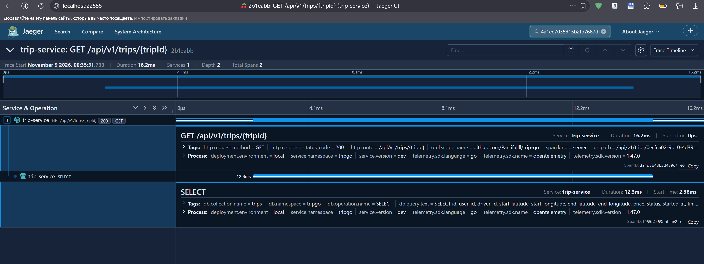
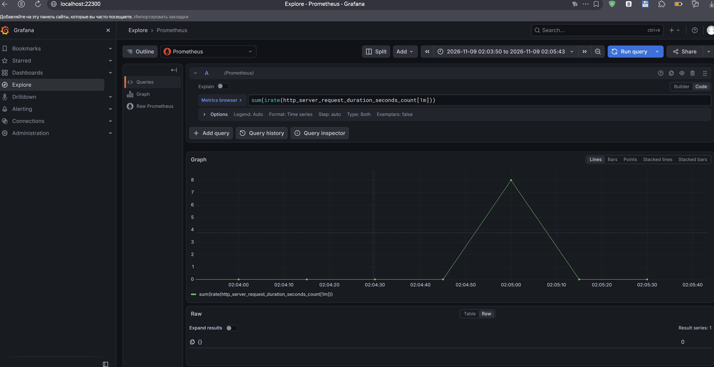

# Лабораторная работа 2. Архитектура, качество кода и observability

## Запуск

```bash
tripgoctl environment start
tripgoctl connect        # формирует .env, печатает ссылки на Jaeger, Grafana, Prometheus
make migrate
make run
```

Проверки:

```bash
make lint
make test                # с -race, печатает покрытие usecase и domain
make test-integration    # нужна запущенная инфра (tripgoctl environment start)
make generate            # OpenAPI-код и моки (go generate ./...)
```

## Переменные окружения

Те же, что в ЛР1 + телеметрия:

| Переменная | Назначение |
|---|---|
| `OTEL_SERVICE_NAME` | имя сервиса |
| `OTEL_EXPORTER_OTLP_ENDPOINT` | адрес коллектора |
| `OTEL_EXPORTER_OTLP_PROTOCOL` | протокол OTLP |
| `OTEL_RESOURCE_ATTRIBUTES` | атрибуты ресурса |
| `OTEL_TRACES_SAMPLER` | сэмплирование трейсов |

## Архитектура

```
cmd/service          main: читает конфиг, вызывает container.New, ждёт сигнала
internal/container   создаёт все зависимости и связывает их (единственное место)
internal/domain/trip сущность Trip, статусы, переходы, доменные ошибки
internal/model       структуры, которые ходят между слоями
internal/usecase     create, get, finish
internal/http        транспорт: ручки, маппинг ошибок, middleware, сервер
internal/repository  работа с PostgreSQL
internal/infra       пул pgx, менеджер транзакций, телеметрия
```

Зависимости направлены внутрь: `http` и `repository` знают про `usecase`, `usecase` знает про `domain`, `domain` не знает ни про кого. Правила проверяет `depguard` в `.golangci.yml`:

- `domain` не импортирует `net/http`, chi, pgx, squirrel, otel и сгенерированный API;
- `usecase` не импортирует `net/http`, chi, pgx, squirrel и сгенерированный API;
- `http/*` не импортирует `repository` и `infra`.

**Интерфейсы.** Объявлены неэкспортируемыми в `contract.go` пакета-потребителя (`usecase/trip/*`, `http/trip/*`, `http/health`, `repository/trip`). Потребитель сам формулирует, что ему нужно, поэтому интерфейсы узкие, а реализацию можно заменить без правок потребителя. Моки генерируются `mockgen` в `mocks_test.go` рядом с кодом.

**Ошибки.** Доменные ошибки лежат в `domain/trip`. Перевод «ошибка → Problem» сделан в одном месте, `http/domainerror`, детали внутренних ошибок клиенту не отдаются.

## Отступления от целевой структуры

- `http/server`: роутер, адаптер к сгенерированному `api.ServerInterface` (он один на весь сервис) и graceful shutdown. Не ручка и не middleware, но относится к транспорту.
- `http/response`: общая запись JSON-ответа для всех ручек.
- `http/trip/dto`: преобразование `trip.Trip` в `api.Trip`, общее для `create`, `get` и `finish`, чтобы не дублировать код.

## Телеметрия

Метрики и трейсы уходят по OTLP в коллектор. Логи: `slog`, JSON, в записи есть `trace_id` и `span_id`.




